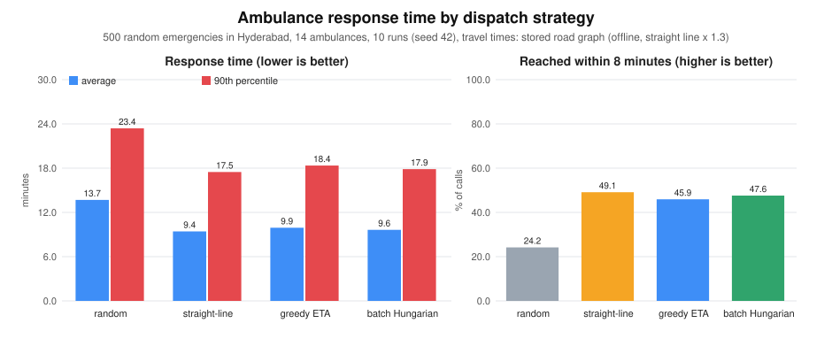

# Dispatch strategy comparison

Generated by `aro_simulate`. 500 random emergencies in Hyderabad per run, 10 runs (seeds 42..51). Travel times: **stored road graph (offline, straight line x 1.3)**.

| Strategy | Avg response (min) | 90th pct (min) | Within 8 min | Hospital overflow | ADVANCED match (HIGH/CRIT) | CRITICAL avg (min) |
|---|---:|---:|---:|---:|---:|---:|
| random | 13.7 ± 0.7 | 23.4 | 24.2 % | 35.6 | 43.3 % | 13.5 |
| straight-line | 9.4 ± 0.6 | 17.5 | 49.1 % | 29.3 | 43.3 % | 9.4 |
| greedy ETA | 9.9 ± 0.7 | 18.4 | 45.9 % | 31.2 | 89.8 % | 11.3 |
| batch Hungarian | 9.6 ± 0.6 | 17.9 | 47.6 % | 30.0 | 84.2 % | 10.1 |

**Batch Hungarian vs greedy ETA, paired by run** (same emergencies in each pair): average response is 0.3 ± 0.2 min lower with batch; batch was better in 10 of 10 runs.

## How to read this

* **Response time** = from the moment the emergency is reported until an ambulance reaches the patient. It includes waiting in the queue when every unit is busy, so it shows how well the fleet is used, not just how fast one unit drives.
* **Avg / 90th percentile**: the 90th percentile is the response time that 9 out of 10 patients beat; it exposes the unlucky tail the average hides. Lower is better.
* **Within 8 min**: share of calls reached within 8 minutes (a common emergency-response target). Higher is better.
* **Speed vs. skill trade-off**: (c) and (d) deliberately keep ADVANCED units for HIGH/CRITICAL patients, which can cost a little average speed compared with a type-blind "nearest unit" rule (b). The ADVANCED-match column shows what that buys. With offline travel times, straight-line distance and road time are almost the same thing, so (b) is a strong baseline for speed; real roads (OSRM) separate them more.
* **Hospital overflow**: patients whose closest hospital (by travel time) had no free bed, so they were taken further away (or the unit had to wait for a bed). Lower is better. It depends mostly on bed supply, so strategies should be similar.
* **ADVANCED match**: of the HIGH and CRITICAL patients, the share served by an ADVANCED life-support unit. The two baselines ignore ambulance type on purpose.
* **CRITICAL avg**: average response time for CRITICAL patients only.
* **± value**: standard deviation of the average between runs (different random emergencies).

## Model and assumptions

* Emergencies arrive randomly (exponential gaps, mean 300 s) at random places in the box 17.33-17.50 N, 78.34-78.56 E (80 % clustered around the centre, 20 % uniform). Severity mix: 30 % LOW, 40 % MEDIUM, 20 % HIGH, 10 % CRITICAL.
* Fleet: 14 ambulances spread over 5 stations, 40 % ADVANCED. Hospitals: the 3 seed hospitals with 15 beds each.
* A call takes: drive to the patient, 5-10 min at the scene, drive to the hospital, 10 min hand-over, then the unit is free again at the hospital. The patient keeps the bed 1-3 hours.
* Strategies (a) and (b) ignore the ambulance type; (c) and (d) use the production rules (ADVANCED for HIGH/CRITICAL, soft penalty in batch mode).
* Batch mode runs at every event (new call or a unit becoming free) on everything waiting; greedy serves the queue in priority order. They only differ when at least two patients wait and at least two units are free at the same moment.
* All strategies see exactly the same emergencies. One run is one random scenario: use `--repeat 5` (or more) before drawing conclusions.
* **Offline mode**: travel times come from the stored road graph (straight line x 1.3 per road segment, shortest path over a 10-nearest-neighbour road network) at 40 km/h, not from real roads. Run without `--offline` for OSRM road travel times.
